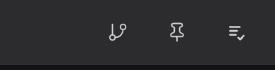
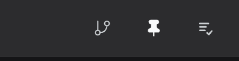

# dsh-plugin-always-on-top

[](https://github.com/jeremytenjo/dsh-plugin-always-on-top/actions/workflows/ci.yml)

Pin the **DeepSeek Harness** desktop window above every other app, straight from the composer.

A pin button sits between the source-control and backlog triggers. It is a grey outline while the
window is normal. Click it and the icon becomes a filled white pin; the Harness window now floats
above other windows. Click again to release it.

| Off | On |
| --- | --- |
|  |  |

## Features

- One 28 × 28 button in the composer, right beside source control.
- Outline pin when off; filled white pin when on.
- Reads the real `BrowserWindow.isAlwaysOnTop()` state, not a UI-only flag.
- Survives a page reload while the window is pinned.
- No app.asar rewrite, no re-signing, no restart after the plugin is loaded.
- English and Chinese labels.

## Install

The desktop app does not ship a `dsh` command, so the reliable path is a local checkout plus a
profile link.

```sh
git clone https://github.com/jeremytenjo/dsh-plugin-always-on-top.git
cd dsh-plugin-always-on-top
python3 scripts/install-local.py
```

The script:

1. backs up `~/.dsh/profiles/desktop/package.json`,
2. adds `"dsh-plugin-always-on-top": "link:/path/to/this/checkout"` to `dependencies`,
3. appends `dsh-plugin-always-on-top` to `dsh.profile.bundles`,
4. creates the `node_modules` symlink.

Then **quit DeepSeek Harness completely** (tray icon → Quit; closing the window only hides it) and
reopen it. The pin appears in the composer.

Set `DSH_DESKTOP_PROFILE` to point at a different profile.

### Manual install

If you prefer editing by hand, add the dependency and **append** the bundle name to the existing
`dsh.profile.bundles` array in `~/.dsh/profiles/desktop/package.json` — do not replace the array:

```json
"dependencies": {
  "dsh-plugin-always-on-top": "link:/absolute/path/to/dsh-plugin-always-on-top"
}
```

```json
"bundles": [
  "…your existing bundles…",
  "dsh-plugin-always-on-top"
]
```

```sh
ln -s /absolute/path/to/dsh-plugin-always-on-top \
  ~/.dsh/profiles/desktop/node_modules/dsh-plugin-always-on-top
```

Quit and reopen the app.

### Uninstall

```sh
cd dsh-plugin-always-on-top
python3 scripts/install-local.py --uninstall
```

Quit and reopen the app. The `package.json.bak-always-on-top` backup is left in place for reference.

## How it works

The Desktop Host is a Node-mode child process and has no `BrowserWindow` access. The shell also ships
no IPC channel for window levels. Patching `app.asar` is the usual workaround, but on macOS it
invalidates the app's code signature and needs two launches.

This plugin takes a smaller route:

```
client button
   │  GET/POST /__dsh/always-on-top
   ▼
Host half (Node-mode child)
   │  SIGUSR1  (asks the Electron main process for its Node inspector)
   ▼
Electron main inspector
   │  BrowserWindow.setAlwaysOnTop(value, 'floating')
   │  BrowserWindow.isAlwaysOnTop()
   ▼
inspector.close()
```

The expression evaluated in the main process is fixed and only interpolates a boolean. The inspector
is opened for the few hundred milliseconds a toggle takes and is closed in a `finally` block. If an
inspector was already open before the plugin touched it, the plugin leaves it alone.

Nothing under `/Applications` is modified.

## Security

This is a local power-user tool, and it deliberately uses a debugger as its control channel.

While a toggle is in flight, the Electron main process exposes its Node inspector on
`127.0.0.1:9229` (or the next free port). Any local process that connects during that short window
could evaluate code in the main process. The plugin closes the inspector as soon as the toggle
finishes, and it never leaves a long-lived eval endpoint behind.

If that trade-off is not acceptable to you, do not install this plugin. A plugin such as
[`dsh-window-control`](https://github.com/YunLiZeMeng/dsh-window-control) takes the app.asar route
instead and comes with its own signing caveats.

The bridge reads Electron's fuse wire before it signals anything. The current build (0.2.1-rc.3,
Electron 44) has `EnableNodeCliInspectArguments` enabled. If a future build disables it, the plugin
refuses to send `SIGUSR1` — which would terminate the app — and the button reports that window
debugging is unavailable.

## Limitations

- **Desktop app only.** `dsh web` started from a terminal has no Electron parent; the button renders
  disabled with an explanation.
- **macOS and Linux** are the primary targets. Windows uses `process._debugProcess` and is untested.
- The level is **not persisted**: after quitting and reopening Harness, the window starts normal.
- `setAlwaysOnTop` controls the window level, not Space membership. A full-screen app on another
  Space can still cover Harness.
- The state is read on mount and after each toggle. If something else changes the window level while
  the page is open, reload the page to resync.
- If another debugger occupies the inspector port range, the toggle fails with an error tooltip.

Tested with DeepSeek Harness `0.2.1-rc.3` and Electron `44.7.0` on macOS (Apple silicon).

## Development

```sh
pnpm install
pnpm test      # host helpers
pnpm build     # src/client.js -> client.js
```

`client.js` is generated by `scripts/build-client.mjs`; do not edit it by hand. CI runs the tests,
rebuilds the client, and fails if the committed bundle is stale.

Layout:

| Path | Role |
| --- | --- |
| `index.js` | Host half: loopback route and the inspector bridge |
| `src/client.js` | Browser half: the composer button |
| `client.js` | Generated browser bundle |
| `cordis.patch.yml` | Bundle layer that inserts the Host plugin |
| `scripts/install-local.py` | Links a checkout into the Desktop profile |
| `test/bridge.test.mjs` | Pure-function tests for the bridge |

## License

MIT © 2026 Jeremy Tenjo
